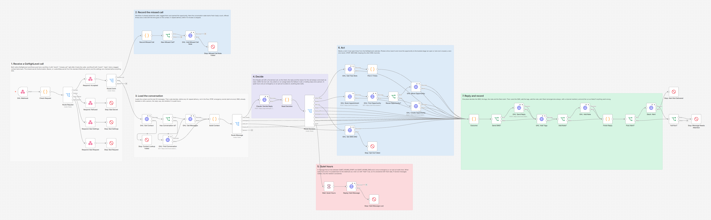
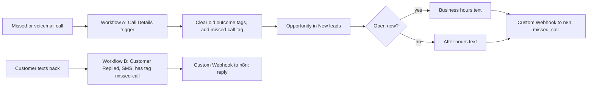
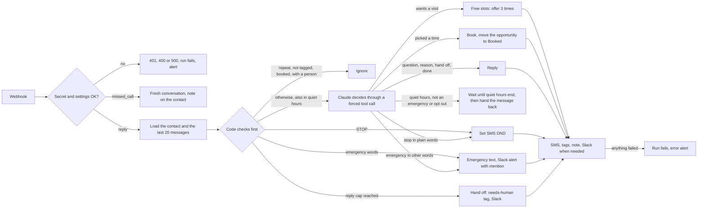

# GoHighLevel Missed Call Text Back with AI Replies: n8n + Claude

When a call to a home services business goes unanswered, GoHighLevel texts the caller back right away. Claude handles their replies in n8n: it finds out why they called, answers from your FAQ, offers real open times from the calendar and books them, and alerts the team at once when the text describes an emergency.

Built as native GoHighLevel workflows (the recipe is in [ghl/native-workflows.md](ghl/native-workflows.md)) plus an n8n workflow for the AI and integration side. The example business is a made up plumber, Northside Plumbing.



## The problem

A plumber under a sink cannot answer the phone. The caller does not leave a voicemail; they call the next company on the list. A missed call text back helps, but it is one canned text: the replies then sit in the inbox until someone is free, nobody asks what the job is, and a burst pipe at 10 PM gets the same "we will get back to you" as a dripping faucet.

## What this does

1. **Texts the caller right away (native GoHighLevel).** A missed or voicemail call to the business line tags the caller, opens an opportunity in "New leads" and sends one of two texts: a business hours text, or an after hours text that says when you open and how to flag an emergency.
2. **Finds out why they called.** When the caller texts back, Claude reads the conversation and asks what the job is, then notes the reason on the contact.
3. **Answers only from your facts.** Hours, service area, the service call fee: Claude answers from `BUSINESS_FAQ` and nothing else. A question the facts do not cover (a price for a repair, a diagnosis) goes to a person.
4. **Offers real open times and books them.** When the customer wants a visit, they get 3 open times from the GoHighLevel calendar. The one they pick is booked, and their opportunity moves from New leads to Booked.
5. **Treats emergencies as emergencies.** Words such as flooding, burst pipe, no water or gas smell skip the AI chat: the customer gets your emergency text, and Slack gets an alert with a channel mention, their words and a link to the contact. Claude catches emergencies in other words too ("water is pouring through the ceiling"), also during quiet hours.
6. **Knows when to hand off.** An upset customer, a request for a person, a question it cannot answer or a Claude outage: the customer gets an honest reply, the contact gets a `needs-human` tag and a note, and Slack gets an alert. A long conversation (the reply cap) is handed off the same way, without another text.
7. **Respects STOP and quiet hours.** STOP and the other opt out words set SMS DND in code, before any AI. Between `QUIET_HOURS_START` and `QUIET_HOURS_END` the assistant does not text. Claude still reads a message that comes in then: an emergency or an opt out, in any words, is handled at once, and anything else waits and is answered when quiet hours end.
8. **Records everything in GoHighLevel.** Tags for each outcome, a note for each event (the missed call, why they called, the booking, the hand off, the emergency, the opt out) and the moved opportunity.
9. **Fails loudly.** Any GoHighLevel, Claude or Slack failure ends the run as failed, and the error workflow posts the reason and a link to the run in Slack.

## How it works

The GoHighLevel side runs as two native workflows, built by hand from [ghl/native-workflows.md](ghl/native-workflows.md):



The n8n side answers both webhooks at once (200) and does the work afterwards:



**Why nobody gets two answers.** Every message the assistant handles is remembered by its id for 7 days, and a repeat delivery is skipped, even when the run that handled the first copy failed. GoHighLevel's workflow webhook carries no message id, so n8n finds the message in the conversation history and uses that id. Only a match from the last 24 hours counts, so a customer who sends the same words again days later still gets an answer.

**How quiet hours work.** A message that arrives in quiet hours still goes to Claude, so an emergency or an opt out in any words is handled at once (the emergency text is the one text that goes out in quiet hours). Anything else waits in an n8n Wait node until they end, then the waiting run posts it back to the same webhook as a new run, so it is answered with fresh data (the customer may have texted again, opted out or been called by your team in the meantime). If they sent several messages overnight, only the newest is answered, with the others in the history.

## Workflow at a glance

| Step | Nodes | What it does |
|---|---|---|
| 1 | GHL Webhook, Check Request, Route Request, Respond: Accepted, Respond: Refused, Respond: Bad Settings, Respond: Bad Request, Stop: Bad Secret, Stop: Bad Settings, Stop: Bad Request, Route Event | One POST webhook for both GoHighLevel workflows. Checks the Bearer token (or the `secret` Custom Data item), every setting and the `event` field, and reads both payload shapes. Only the fields the workflow needs leave the first node, so the secret is never copied into a saved run |
| 2 | Record Missed Call, New Missed Call?, GHL: Add Missed Call Note, Stop: Missed Call Note Failed | A missed call resets the conversation state and adds a note with the time and which text went out. A repeat delivery within 10 minutes is skipped |
| 3 | GHL: Get Contact, Stop: Contact Lookup Failed, Has Conversation Id?, GHL: Find Conversation, GHL: Get Messages | Loads the contact (tags, DND) and the last 20 messages of the conversation |
| 4 | Build Context, Route Message | Code decides before any AI: repeat delivery, no `missed-call` tag, STOP words, emergency words, DND, booked or with a person, the reply cap, quiet hours. Builds the Claude request |
| 5 | Claude: Decide Reply, Read Decision, Route Decision | One Claude call with a forced, strict tool call: the intent, the SMS, the reason for the call and a line for the team. No tool call, `max_tokens` or an outage takes the fallback route. In quiet hours only an emergency or an opt out is acted on |
| 6 | Wait: Quiet Hours, Replay Held Message, Stop: Held Message Lost | Holds a quiet hours message until quiet hours end, then posts it back to the webhook as a new run |
| 7 | GHL: Get Free Slots, Pick 3 Times | Free slots for the next `SLOT_SEARCH_DAYS` days in the business time zone. Picks 3, one per day where possible, skipping times this customer already saw |
| 8 | GHL: Book Appointment, GHL: Find Opportunity, Reuse Opportunity?, GHL: Move Opportunity, GHL: Create Opportunity | Books the picked time, then moves the open (or else lost) opportunity in `GHL_PIPELINE_ID` to `GHL_BOOKED_STAGE_ID`, or creates one. A won opportunity is never touched |
| 9 | GHL: Set SMS DND, Stop: Opt Out Failed | Turns on SMS DND and keeps the contact's other DND channels as they were |
| 10 | Outcome, Send SMS?, GHL: Send Reply, GHL: Add Tags, Add Note?, GHL: Add Note | One place decides the SMS, the tags and the note, then sends them through the Conversations and Contacts APIs |
| 11 | Finish Reply, Post Alert?, Slack: Alert, Stop: Alert Not Delivered, Fail Run?, Stop: Message Needs Attention | Slack for bookings, hand offs and emergencies. Anything that went wrong ends the run as failed with the reason |

## Tags

| Tag | Added by | Meaning |
|---|---|---|
| `missed-call` | Workflow A | In the missed call flow. Workflow B only forwards texts from contacts with this tag |
| `missed-call-replied` | n8n | Texted back at least once |
| `missed-call-booked` | n8n | Booked by text. The assistant stops replying |
| `missed-call-needs-human` | n8n | A person takes over. The assistant stops replying |
| `missed-call-emergency` | n8n | Reported a possible emergency. The team was alerted |
| `missed-call-opted-out` | n8n | Texted STOP or asked to stop. SMS DND is on |
| `missed-call-done` | n8n | Said they do not need help anymore |

Workflow A removes the booked, needs-human, emergency and done tags when the contact calls again, so a new missed call starts a new conversation.

## What the customer and the team see

A conversation from the test run (all data made up). The first text comes from GoHighLevel workflow A, the list of times and the confirmation are written by the n8n workflow, and the other replies come from Claude (scripted in the test):

```
Northside Plumbing: Hi, this is Northside Plumbing. Sorry we missed your call. We are closed right now and open again at 7 AM. Tell us what you need and we will text you back. For flooding, a burst pipe or a gas smell, reply EMERGENCY.
Maya:               Hi, yes I called about my water heater. It is making a loud banging noise
Northside Plumbing: Sorry to hear that, Maya. Is it a gas or an electric water heater, and is it leaking at all?
Maya:               It's gas, no leak. Do you charge to come out?
Northside Plumbing: Our service call fee is $89, and it goes toward the repair if you hire us. Would you like us to come take a look?
Maya:               Yes please, can someone come tomorrow?
Northside Plumbing: Sure thing! Here are a few open times:
                    1) Tue, Oct 27, 9:00 AM
                    2) Wed, Oct 28, 9:00 AM
                    3) Thu, Oct 29, 9:00 AM
                    Reply 1, 2 or 3 to book.
Maya:               2 works
Northside Plumbing: You are booked for Wed, Oct 28, 9:00 AM. See you then! If anything changes, just reply here.
```

In GoHighLevel, the appointment is on the calendar (one hour, confirmed), the opportunity moved from New leads to Booked, and the contact has the tags `missed-call`, `missed-call-replied` and `missed-call-booked` and three notes: the missed call, why they called, and the booking.

In Slack, from the same run (the time zone is a test zone; real alerts show yours, for example `America/Chicago`):

```
*Booked from a missed call*: Maya Lopez (+13125550101)
Wed, Oct 28, 9:00 AM (Etc/GMT+3)
Reason: water heater banging
https://app.gohighlevel.com/v2/location/loc-northside-1/contacts/detail/c-maya
```

```
<!here> *Possible emergency from a missed call*: Owen Price (+13125550102)
They said: "Our basement is flooding!!"
They got the emergency text. Call them now (matched "flooding").
https://app.gohighlevel.com/v2/location/loc-northside-1/contacts/detail/c-owen
```

```
*Missed call lead needs a person*: Ivy Chen (+13125550107)
They said: "How much to replace a 50 gallon water heater?"
Assistant replied: "Good question! A team member will text you with a price shortly."
Wants a price for a 50 gallon water heater
https://app.gohighlevel.com/v2/location/loc-northside-1/contacts/detail/c-ivy
```

## Setup

**You need:** self-hosted n8n reachable over HTTPS, a GoHighLevel sub-account with an SMS number, a calendar and a pipeline, an Anthropic API key and a Slack incoming webhook.

1. Add the variables below to your n8n environment and restart n8n. The nodes read them with `$env`, so self-hosted n8n needs `N8N_BLOCK_ENV_ACCESS_IN_NODE=false`. (n8n Cloud does not allow `$env`. There, replace `$env.` with `$vars.` and create the same names under Variables.)
2. Import `workflow/error-alert-slack.json` and **activate it**. n8n 2.x only runs an error workflow that is active.
3. Import `workflow/ghl-missed-call-text-back-ai.json`, choose the error alert workflow as its **Error Workflow** and activate it. It listens on `/webhook/ghl-missed-call-text-back`.
4. In GoHighLevel, build workflows A and B from [ghl/native-workflows.md](ghl/native-workflows.md) and turn off the built-in Missed Call Text Back.
5. Test with your own phones: a missed call, a reply, a booking, an emergency and a STOP.

Step by step, with the token scopes, the IDs and troubleshooting: [docs/setup.md](docs/setup.md).

| Variable | Required | Where to find it |
|---|---|---|
| `GHL_API_KEY` | yes | GoHighLevel → Settings → Private Integrations. Token starts with `pit-`. The 9 scopes it needs are in [docs/setup.md](docs/setup.md) |
| `GHL_LOCATION_ID` | yes | GoHighLevel → Settings → Business Profile |
| `GHL_CALENDAR_ID` | yes | The calendar's settings page; the ID is in the URL |
| `GHL_PIPELINE_ID`, `GHL_BOOKED_STAGE_ID` | yes | `GET /opportunities/pipelines` (one curl call, shown in the setup guide) |
| `GHL_WEBHOOK_SECRET` | yes | Any long random string. Both GoHighLevel workflows send it as their Bearer token |
| `ANTHROPIC_API_KEY` | yes | console.anthropic.com → API keys |
| `SLACK_WEBHOOK_URL` | yes | Slack incoming webhook for bookings, hand offs, emergencies and error alerts |
| `BUSINESS_NAME`, `BUSINESS_ABOUT` | recommended | How the assistant names and describes the business |
| `BUSINESS_FAQ` | recommended | The only facts Claude may use to answer questions. Anything else goes to a person |
| `BUSINESS_TZ` | recommended | Time zone for quiet hours, open times and notes (default `America/Chicago`) |
| `QUIET_HOURS_START`, `QUIET_HOURS_END` | no | No assistant texts between these times, for example `21:00` and `08:00`. Both empty means any hour |
| `EMERGENCY_WORDS` | no | Comma separated words that skip the AI and alert the team. Empty uses the plumbing list in the workflow |
| `EMERGENCY_REPLY` | no | The text an emergency gets. Make it match your real on-call process |
| `SLACK_EMERGENCY_MENTION` | no | Put in front of emergency alerts. Not set: `<!here>`; set but empty: none |
| `ANTHROPIC_MODEL` | no | Default `claude-sonnet-5`; `claude-haiku-4-5` is cheaper. `claude-opus-5-5` and `claude-fable-5-1` refuse forced tool calls, and the Fable and Mythos models refuse thinking turned off, so the workflow refuses to run with them |
| `MAX_AI_REPLIES` | no | Assistant texts per conversation before a person takes over (default 6, plus 2 while offered times are open) |
| `CONVERSATION_DAYS` | no | A conversation quiet for this many days starts over (default 14) |
| `APPOINTMENT_MINUTES`, `SLOT_SEARCH_DAYS` | no | Length of a booked visit (default 60, use the calendar's own slot length) and how far ahead to look for times (default 7, at most 30) |
| `TAG_PREFIX` | no | Prefix of the tags (default `missed-call`). Change the tags in the GoHighLevel workflows to match |
| `DND_ALL_CHANNELS` | no | `true` sets DND on every channel after an opt out, not only SMS |
| `GHL_FROM_NUMBER`, `GHL_APP_URL` | no | The number replies go out from, and your white label domain for links in Slack |
| `SELF_WEBHOOK_URL` | no | Where a held message is posted back when quiet hours end, if n8n cannot reach its own public URL |

Only text people who contacted you or agreed to hear from you. In the US, sending SMS through a GoHighLevel number also needs A2P 10DLC registration.

## Testing

The n8n workflow was tested end to end on n8n 2.19.5 against **mock GoHighLevel, Claude and Slack APIs**, so no real account was touched and no real text was sent. The GoHighLevel side was not run: it is built natively in GoHighLevel, and the test plays what its two workflows do (tags, the opportunity, the missed call text, the customer's message) and sends n8n the exact requests the recipe sets up, in the Custom Webhook shape (key/value form body and raw JSON) and the standard Webhook shape (Custom Data nested and at the top level).

The mock GoHighLevel API v2 keeps real state (contacts, tags, DND, notes, conversations, a calendar with open times, appointments, opportunities) and rejects what the real API would reject: a wrong token, the wrong `Version` header for the endpoint, unknown body properties, a note without a body, slots that are not free, a second opportunity in the same pipeline, texts to contacts with DND, and so on. The mock Claude returns scripted answers but rejects malformed Messages API requests, including a strict tool schema the API would refuse. Each distinct Claude request was also checked against Anthropic's free token counting endpoint.

The test also imports and activates the error alert workflow and checks that exactly the expected runs failed, each with exactly one alert linked to it, and scans every saved run for the secret and the API keys.

All 74 checks across 60 scenarios pass:

| Scenario | Result |
|---|---|
| Wrong or missing secret, a body without an event, broken settings, an empty secret setting | 401, 400 or 500 with every problem listed, nothing loaded or written, run fails, alert |
| Missed call (key/value body, JSON body, standard Webhook action) | Note with the time and which text went out; a repeat delivery within 10 minutes adds nothing; a call from another location is refused with 400 and an alert |
| First reply, a question, wants a visit, picks a time | Claude gets the history inside tags and the facts; the reason is noted; 3 real open times; the appointment is booked for the exact slot; the opportunity from workflow A moves to Booked; confirmation, tags, note and a Slack alert |
| Same message delivered twice (Custom Webhook and standard shape, also after a failed run) | Second copy ignored, through the id found in the conversation history |
| Same words again two days later | Answered as a new message |
| Emergency words / emergency in other words / again within the hour | Emergency text, emergency and needs-human tags, note, Slack with `<!here>`; no second emergency text within the hour, but a new alert |
| Emergency while Slack is down | Retried, then the run fails carrying the whole alert |
| STOP, CANCEL from a booked customer, opt out in plain words | SMS DND (other channels kept), opted-out tag, note, no reply; Slack says a booked appointment is still on the calendar |
| STOP after GoHighLevel already set a permanent SMS DND | The permanent DND is kept as it was |
| Asks for a person, a question the facts do not cover, does not need help anymore | Hand off with the reply, tag, note and alert; or a short goodbye and the done tag |
| Reply cap, and the cap reached by the text that offers times | Hand off without Claude; but a customer picking one of the offered times is still booked |
| Calls again after an earlier conversation | Fresh conversation, the assistant answers again |
| Customer text with `<!channel>` | Escaped in Slack, pings nobody |
| Contact without the tag, an email reply | Ignored |
| A message type the workflow does not know | 400 and an alert that names the value, so a text is never dropped quietly |
| A contact name that tries to add a rule to the prompt | Stays out of the system prompt; inside `<customer>` its angle brackets are removed |
| Claude down (529), down with an opt out word, no tool call, `max_tokens` | Holding reply (none when the message may be an opt out), needs-human tag, run fails with their words |
| Contact or conversation cannot be loaded, calendar down or full, slot taken | Retried; honest replies and hand offs; only real failures fail the run |
| Lost opportunity, no opportunity, only a won one | Reopened / created / never reopened and the duplicate refusal flagged |
| An offered time has passed / picked the passed time | "2" still books the second time from their text / told so and given new times |
| DND update fails, reply SMS rejected, 429 on a send | URGENT alert / the text to send by hand / retried, one text |
| Quiet hours | Messages wait and are answered when quiet hours end (not before), once, to the newest message; an emergency and an opt out during quiet hours are handled at once, in emergency words or STOP and in other words through Claude |
| Saved runs | No API key in any saved run; the webhook secret only where the standard Webhook action put it in the body |

Full results, the requests the workflow sent and the docs they were checked against: [docs/test-report.md](docs/test-report.md). Run the same tests with [tests/e2e_mock_test.py](tests/e2e_mock_test.py). What testing found and fixed is in [CHANGELOG.md](CHANGELOG.md).

## What it handles when things go wrong

| Situation | What happens |
|---|---|
| A forged call to the webhook | 401, nothing loaded or sent, and an alert. An empty secret setting refuses everything |
| A setting is missing or wrong | 500 with the list, the run fails, and the alert names every problem. Nothing is texted |
| GoHighLevel sends a body the workflow cannot read | 400 with the reason, and an alert that points at the recipe. A message type the workflow does not know is refused the same way, so a text is never dropped without notice |
| A call from another sub-account | 400 and an alert: either `GHL_LOCATION_ID` is wrong or the GoHighLevel workflow was copied into another sub-account. Nothing is loaded or sent |
| GoHighLevel delivers a webhook twice | The missed call is noted once; a message is answered once (message id ledger, 7 days) |
| GoHighLevel rate limit or a short outage | API calls are tried up to 3 times, 2 seconds apart. The appointment and a new opportunity are never retried, so they cannot be created twice; if they fail, a person takes over |
| Claude is down, answers without the tool call or runs out of tokens | A holding reply and the needs-human tag. No holding reply when the message contains an opt out word, because it may be an opt out; a person decides |
| An emergency while Slack is down | The customer still gets the emergency text, and the run fails with the whole alert in its error message, so the error workflow and the n8n execution list carry it |
| The customer texts STOP | SMS DND is set before any AI call. A permanent DND that GoHighLevel already set from the STOP is kept as it is. If GoHighLevel refuses the update, an URGENT alert says to set it by hand |
| A booked customer texts CANCEL | Honored as an opt out, as carriers require. The workflow never cancels an appointment, so Slack says the booking is still on the calendar |
| The picked time is gone, or the calendar is down or full | An honest text that a person will confirm a time, the needs-human tag and an alert |
| The conversation history cannot be loaded | The customer is still answered (Claude sees only the newest message), and the run fails, because it usually means a missing scope |
| The booking works but the opportunity update fails | The customer is still confirmed; the alert says which step to finish by hand |
| The reply SMS is rejected | The alert includes the exact text to send by hand |
| A held message cannot be handed back after quiet hours | The run fails with the customer's words, so a person can answer |
| Customer text contains Slack markup such as `<!channel>` | Escaped before it reaches Slack, so it shows as text and pings nobody |

## Cost

Missed calls themselves do not use Claude. Each customer text the assistant answers is one Claude call (two for a text that arrives in quiet hours: one to check for an emergency or an opt out, one when it is answered) of about 1,900 to 2,500 input tokens (measured with Anthropic's token counter on the test conversation, growing with the history) and usually under 150 output tokens. On `claude-sonnet-5` ($2 per million input tokens, $10 per million output tokens) that is under 1 cent per text; on `claude-haiku-4-5` ($1 and $5) about a third of a cent. On the GoHighLevel side, the Custom Webhook is an LC Premium action: 100 free lifetime executions, then $0.01 per execution, one per missed call and one per customer text (the standard Webhook action is free). SMS is billed at your LC Phone rates.

## Limitations and next steps

- The GoHighLevel workflows were not run against a live account. Their trigger, filter and action names were checked against HighLevel's help center; the items the docs do not confirm are marked in [ghl/native-workflows.md](ghl/native-workflows.md). The most important: the If/Else conditions on the current day and hour (business hours versus after hours) are not in the current docs, and there is a single text fallback.
- n8n request shapes follow GoHighLevel's OpenAPI files and the live API reference, and were tested against mocks only. The calls use the `Version` values those files list (`2021-04-15` and `2021-07-28`). In October 2026 HighLevel's API reference shows `v3` as the latest version and marks `2021-04-15` as "no longer actively maintained"; the older versions are still documented, and some v3 shapes differ (for example lowercase DND channel names), so moving to v3 means checking each call again. Two doc quirks: the send message docs mark `status` as required (the GitHub file also `subType`), which fits custom providers rather than SMS, so the workflow sends the documented SMS fields and this is the first thing to confirm on a real sub-account, and the messages response is flat in the GitHub file but nested in the live reference (both are read).
- Conversation state (reply counts, offered times, the reason for the call, message ids already handled) lives in n8n's workflow static data. n8n saves it as one block per workflow, so two runs at the same moment can overwrite each other's changes: a repeat delivery may not be caught (two answers), offered times may be forgotten (the customer is offered times again), a reply may not be counted, or the fresh start after a new missed call may be lost (an old reply count can then hand the caller to a person early). Held messages are spread over up to two minutes per contact when quiet hours end for this reason. At higher volume, move the state to Redis, Postgres or an n8n data table.
- The emergency check is a phrase match. It errs toward alerting: "no flooding, just a slow drain" alerts the team. Claude catches emergencies in other words, but only when the message reaches it: texts from contacts who are booked, handed to a person or done, or past the reply cap, get the phrase match only.
- A message during quiet hours gets no reply until they end, unless it is an emergency; the after hours text from workflow A tells the customer when you open and how to flag an emergency. Each quiet hours message costs a second Claude call when it is answered.
- Workflow A texts every missed call. Two missed calls a minute apart send two texts; n8n notes the call once.
- GoHighLevel's workflow webhook carries no message id, so the message is matched by its words in the history. If a customer sends the same words twice within 24 hours and the second webhook arrives before GoHighLevel shows the new message in the history, the second one is taken as a repeat and not answered.
- GoHighLevel has no idempotency key for sending messages. If a send times out after GoHighLevel already accepted it, the retry can send the same text twice. Rate limit errors are safe to retry.
- The standard Webhook action cannot send headers, so its secret travels in the body and n8n saves it with every run. The Custom Webhook's Bearer token is hidden in saved runs.
- Booking only creates the appointment. Rescheduling and cancelling are left to your team.
- Every refused webhook call raises a Slack alert. A flood of forged calls would flood Slack too; put n8n behind a proxy with rate limits for public use.
- API keys are read from environment variables. For production, move them into n8n credentials.
- The prompts and the time labels are written in English (en-US).

## About

Built by **Romiel Inolino**, AI and CRM Automation Specialist working with GoHighLevel, Monday.com, ClickUp, n8n, Make and Zapier.
Portfolio and case studies: [romielwillautomate.dev](https://romielwillautomate.dev)

This repository is a portfolio implementation. Credentials, API keys and customer data are not included, and all test data is made up.
